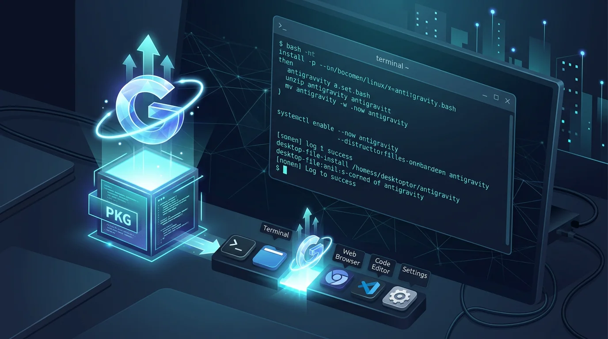
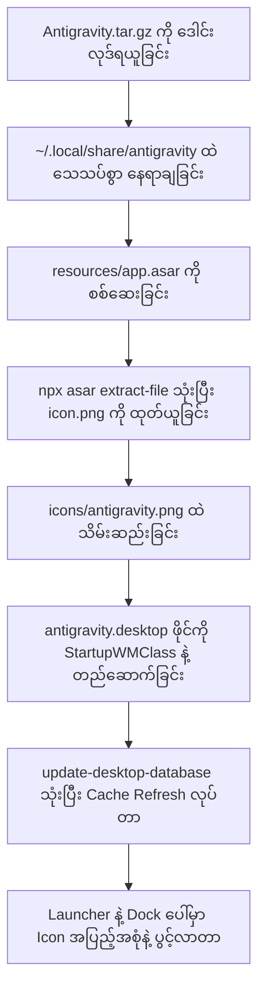

Google Antigravity ကို Linux (Debian / Ubuntu / Arch) ပေါ်မှာ အသုံးပြုဖို့ ဒေါင်းလုဒ်ဆွဲလိုက်တဲ့အခါ တရားဝင် `.deb` သို့မဟုတ် `.rpm` installer အသင့်မပါဘဲ `.tar.gz` archive အနေနဲ့ပဲ ရရှိတာကို တွေ့ရပါမယ်။

ဒီ archive ကို ဖြည်ပြီး သုံးရုံနဲ့ ပြီးမသွားဘဲ Application Menu မှာ Icon မပေါ်တာ၊ Dock မှာ App အမှတ်တံဆိပ် မပြဘဲ Generic Gear Icon သာ ပေါ်နေတာ၊ Shortcut ကနေ နှိပ်ဖွင့်ရင် Sandbox Permission ကြောင့် မပွင့်တာနဲ့ ယခင် install လုပ်ထားတဲ့ version အဟောင်းတွေ ရှုပ်ထွေးနေတာတွေကို ကြုံတွေ့ခဲ့ရပါတယ်။

ဒီနေ့မှာတော့ ဒီပြဿနာတွေကို အရင်းအမြစ်ကနေစပြီး ဘယ်လို စနစ်တကျ ဖြေရှင်းခဲ့သလဲ၊ Electron ရဲ့ `app.asar` ထဲကနေ မူရင်း App Icon ကို ဘယ်လို ထုတ်ယူရသလဲ၊ ပြီးပြည့်စုံတဲ့ `.desktop` Launcher ဘယ်လို သတ်မှတ်ရသလဲဆိုတဲ့ လက်တွေ့ လုပ်ဆောင်ခဲ့ပုံ မှတ်တမ်းကို ပြန်လည် မျှဝေပေးလိုက်ပါတယ်။



---

## ၁။ ကြုံတွေ့ခဲ့ရတဲ့ ပြဿနာ ၄ ခု

Linux Desktop ပေါ်မှာ Antigravity ကို သွင်းတဲ့အခါ အောက်ပါ ပြဿနာတွေကို တစ်ခုပြီးတစ်ခု ရင်ဆိုင်ခဲ့ရပါတယ်-

1. **တရားဝင် Installer မရှိဘဲ Tarball သာ ဖြစ်နေခြင်း:**
   - Linux အတွက် `.deb` package မရှိဘဲ `Antigravity.tar.gz` သာ ပေးထားတာကြောင့် Filesystem ထဲမှာ သေသပ်တဲ့ directory structure ကို ကိုယ်တိုင် သတ်မှတ်ပေးရပါတယ်။
2. **Desktop Launcher မှာ Icon မပေါ်ခြင်း (Blank / Gear Icon):**
   - Archive ကို ဖြည်လိုက်တဲ့ folder ထဲမှာ desktop အတွက် တိုက်ရိုက်သုံးနိုင်တဲ့ standalone `.png` သို့မဟုတ် `.svg` icon ဖိုင် သီးသန့် ပါမလာပါဘူး။
3. **Application Menu ကနေ ဖွင့်မရခြင်း (Sandbox Issue):**
   - Linux distributions အများစု (ဥပမာ Debian 13/Ubuntu လိုမျိုး) မှာ Electron Sandbox က unprivileged user namespaces ကန့်သတ်ချက်ကြောင့် Launcher ကနေ နှိပ်ရင် မပွင့်ဘဲ ငြိမ်နေတတ်ပါတယ်။
4. **Dock / Taskbar မှာ Icon မချိတ်မိခြင်းနဲ့ Version အဟောင်းများ ရောထွေးနေခြင်း:**
   - App ပွင့်လာပေမဲ့ Dock ပေါ်မှာ မူရင်း Icon မပြဘဲ Generic Window Icon အနေနဲ့ သီးသန့် ခွဲထွက်နေတာ၊ အရင် install အဟောင်းတွေက `.desktop` ဖိုင်တွေ ကျန်နေတာတွေ ဖြစ်ပေါ်ခဲ့ပါတယ်။

---

## ၂။ ဖြေရှင်းပုံ လုပ်ငန်းစဉ် အဆင့်ဆင့်



---

### (က) User Space ထဲ သေသပ်စွာ နေရာချခြင်း

App ကို System-wide (`/opt`) ထဲ ထည့်တာထက် ကိုယ့်ရဲ့ User Directory အောက်က `~/.local/share/antigravity` ထဲမှာ ထားတာက Permission ပြဿနာတွေ ကင်းဝေးစေပြီး update လုပ်ရတာ ပိုလွယ်ကူပါတယ်။

```bash
# Archive ကို ဖြည်ခြင်း
tar -xzf Antigravity.tar.gz

# User directory သတ်မှတ်ပြီး ရွှေ့ပြောင်းခြင်း
mkdir -p ~/.local/share/antigravity
mv Antigravity-x64/* ~/.local/share/antigravity/
```

ဖိုင်တွေကို စစ်ဆေးကြည့်တဲ့အခါ အဓိက binary ဖြစ်တဲ့ `antigravity` executable နဲ့ `resources/` directory ကို တွေ့ရပါမယ်။

---

### (ခ) `app.asar` ထဲကနေ မူရင်း Icon ကို ထုတ်ယူခြင်း

Archive ထဲမှာ သီးသန့် icon ဖိုင် မပါတဲ့အတွက် Electron application တွေရဲ့ core bundle ဖြစ်တဲ့ `resources/app.asar` ကို စစ်ဆေးကြည့်ခဲ့ပါတယ်။

ဒီ `app.asar` ဖိုင်ဆိုတာ Electron app တွေရဲ့ source code တွေနဲ့ assets တွေကို archive လုပ်ပြီး ပေါင်းထည့်ထားတဲ့ format တစ်ခု ဖြစ်ပါတယ်။ အထဲက icon ကို ထုတ်ယူဖို့အတွက် Electron ရဲ့ တရားဝင် tool တစ်ခုဖြစ်တဲ့ `asar` ကို အသုံးပြုရပါမယ်။

#### စက်ထဲမှာ Node.js / npm နဲ့ asar မရှိသေးရင် အရင်ထည့်သွင်းခြင်း

အကယ်၍ စက်ထဲမှာ Node.js နဲ့ npm မရှိသေးဘူးဆိုရင် Terminal ကနေ အောက်ပါအတိုင်း အလွယ်တကူ အရင် install လုပ်ပေးနိုင်ပါတယ်-

```bash
# Debian / Ubuntu ပေါ်မှာ Node.js နဲ့ npm ကို ထည့်သွင်းခြင်း
sudo apt update && sudo apt install -y nodejs npm
```

Node.js ရှိပြီးသားဆိုရင် `asar` utility ကို သုံးဖို့ နည်းလမ်း ၂ မျိုး ရှိပါတယ်-

1. **Global Package အဖြစ် ထည့်သွင်းနည်း (အမြဲတမ်း သုံးလိုပါက):**
   ```bash
   sudo npm install -g asar
   ```
2. **Install မလုပ်ဘဲ `npx` နဲ့ တိုက်ရိုက် သုံးနည်း (ပိုအဆင်ပြေစေတဲ့ နည်းလမ်း):**
   - Node.js/npm ပါပြီးသားဆိုရင် system ထဲ package အပိုတွေ install လုပ်မနေတော့ဘဲ `npx --yes asar` command နဲ့ on-the-fly တန်းသုံးလို့ ရပါတယ်။

#### `app.asar` ကို စစ်ဆေးပြီး Icon ထုတ်ယူခြင်း

အရင်ဆုံး bundle ထဲမှာ icon ဖိုင် ဘယ်နာမည်နဲ့ ပါသလဲဆိုတာ စစ်ဆေးကြည့်လိုက်ပါတယ်-

```bash
# asar တိုက်ရိုက် သုံးခြင်း သို့မဟုတ် npx သုံးခြင်း
asar list ~/.local/share/antigravity/resources/app.asar | grep -i "icon\|png\|svg"
# (သို့မဟုတ် npx နဲ့ ဆိုရင်)
npx --yes asar list ~/.local/share/antigravity/resources/app.asar | grep -i "icon\|png\|svg"
```

ဒီအခါ bundle ထဲမှာ `icon.png` နဲ့ `trayTemplate.png` ရှိနေတာကို တွေ့ရပါတယ်။ ဒါကြောင့် အဲဒီဖိုင်တွေကို အလွယ်တကူ ထုတ်ယူနိုင်ပါတယ်-

```bash
# Icons directory ဆောက်ခြင်း
mkdir -p ~/.local/share/antigravity/icons

# asar ကနေ icon.png ကို တိုက်ရိုက် ထုတ်ယူခြင်း
npx --yes asar extract-file ~/.local/share/antigravity/resources/app.asar icon.png
mv icon.png ~/.local/share/antigravity/icons/antigravity.png

# Tray icon ကိုလည်း လိုအပ်ပါက ထုတ်ယူထားနိုင်ခြင်း
npx --yes asar extract-file ~/.local/share/antigravity/resources/app.asar trayTemplate.png
mv trayTemplate.png ~/.local/share/antigravity/icons/tray.png
```

အကယ်၍ `asar` ကို global သွင်းထားပြီးသားဆိုရင် `npx --yes asar` အစား `asar extract-file ...` လို့ တိုတိုတုတ်တုတ် တိုက်ရိုက် ရိုက်ထည့်နိုင်ပါတယ်။

ဒီနည်းနဲ့ မူရင်း အရည်အသွေးမြင့် Antigravity PNG Icon ကို အောင်မြင်စွာ ရရှိသွားပါတယ်။

---

### (ဂ) Desktop Entry (`antigravity.desktop`) တည်ဆောက်ခြင်း

Application Menu ထဲမှာ ပေါ်လာစေဖို့နဲ့ Dock မှာ ကောင်းမွန်စွာ အလုပ်လုပ်စေဖို့ `~/.local/share/applications/antigravity.desktop` ဖိုင်ကို ဖန်တီးပေးရပါမယ်။

ဒီနေရာမှာ သတိပြုရမှာက Linux ရဲ့ Desktop Entry (XDG Specification) စံနှုန်းအရ `.desktop` ဖိုင်တွေရဲ့ `Exec` နဲ့ `Icon` နေရာမှာ `~` (tilde) ဒါမှမဟုတ် `$HOME` လို့ ရေးထားရင် Desktop Environment (GNOME/KDE) တွေက အလိုအလျောက် expand မလုပ်ပေးနိုင်ဘဲ Absolute Path အပြည့်အစုံ လိုအပ်တာ ဖြစ်ပါတယ်။

ဒါကြောင့် စက်ရဲ့ Username အလိုက် အလိုအလျောက် Auto-detect ဖြစ်သွားစေဖို့ အောက်ပါ Bash Here-Document (`cat <<EOF`) command တစ်ကြောင်းတည်းနဲ့ တိုက်ရိုက် ဖန်တီးပေးနိုင်ပါတယ်-

```bash
cat <<EOF > ~/.local/share/applications/antigravity.desktop
[Desktop Entry]
Name=Antigravity
Comment=Google Antigravity Agentic Desktop
Exec=$HOME/.local/share/antigravity/antigravity --no-sandbox %U
Icon=$HOME/.local/share/antigravity/icons/antigravity.png
Type=Application
Terminal=false
Categories=Development;
StartupNotify=true
StartupWMClass=Antigravity
MimeType=x-scheme-handler/antigravity;text/html;
EOF
```

ဒီ Command ကို Run လိုက်တဲ့အခါ Bash က `$HOME` နေရာမှာ လက်ရှိ သုံးစွဲနေတဲ့ User ရဲ့ တကယ့် Home Path (ဥပမာ `/home/<username>`) ကို အလိုအလျောက် အစားထိုးပြီး သေသပ်တဲ့ `.desktop` ဖိုင်ကို ဆောက်ပေးသွားမှာ ဖြစ်ပါတယ်။

(အကယ်၍ nano သို့မဟုတ် Text Editor တစ်ခုခုနဲ့ ကိုယ်တိုင် လက်နဲ့ ရိုက်ထည့်မယ်ဆိုရင်တော့ `$HOME` နေရာမှာ ကိုယ့်ရဲ့ Username လမ်းကြောင်း အပြည့်အစုံကို အစားထိုးပေးရပါမယ်။)

ဒီနေရာမှာ သတိထားရမယ့် အဓိက Key ၂ ခု ရှိပါတယ်-

1. **`--no-sandbox` Parameter:**
   - အချို့ Linux စနစ်တွေမှာ root-owned `chrome-sandbox` (SUID) မရှိရင် Electron app တွေ crash ဖြစ်တတ်တာမို့ Exec path အနောက်မှာ `--no-sandbox %U` ထည့်ပေးရပါတယ်။
2. **`StartupWMClass=Antigravity`:**
   - ဒါဟာ အရေးကြီးဆုံး အချက်ဖြစ်ပါတယ်။ ဒီ key မပါရင် GNOME သို့မဟုတ် KDE Dock က ပွင့်လာတဲ့ Window ရဲ့ Window Class ကို Launcher Icon နဲ့ မချိတ်ဆက်နိုင်ဘဲ Dock ပေါ်မှာ မီးခိုးရောင် Generic Icon အသစ်တစ်ခု ထပ်ထွက်နေမှာ ဖြစ်ပါတယ်။

Desktop Entry ရေးပြီးတဲ့အခါ စနစ်ရဲ့ Application Database ကို Refresh လုပ်ပေးရပါမယ်-

```bash
update-desktop-database ~/.local/share/applications/
```

---

### (ဃ) ယခင် Version အဟောင်းများနှင့် အမှိုက်များ ရှင်းလင်းခြင်း

စနစ်ထဲမှာ ယခင်က စမ်းသပ်သွင်းထားတဲ့ Version အဟောင်းတွေ ရှိမနေစေဖို့ စစ်ဆေးပြီး ဖယ်ရှားခဲ့ပါတယ်-

```bash
# သက်ဆိုင်ရာ desktop ဖိုင်ဟောင်းများ ရှာဖွေခြင်း
find ~ /usr/share/applications -name "*antigravity*" 2>/dev/null

# Version အဟောင်းက ကျန်နေခဲ့တဲ့ desktop shortcut များကိုသာ ရှင်းထုတ်ခြင်း
# (သတိပြုရန်: 'Antigravity Tools' က သီးခြား tool ဖြစ်တာကြောင့် မဖျက်မိပါစေနဲ့)
sudo rm -f /usr/share/applications/antigravity-2.0.desktop
sudo update-desktop-database /usr/share/applications/
```

ဒီနေရာမှာ သတိထားရမှာက `find` နဲ့ ရှာလိုက်တဲ့အခါ `Antigravity Tools.desktop` ဆိုတာမျိုး တွေ့ရနိုင်ပါတယ်။ ဒါက helper tools တွေအတွက် သီးခြား App တစ်ခု ဖြစ်တာကြောင့် သူ့ကို မဖျက်ဘဲ ချန်ထားရပါမယ်။ Version အဟောင်းက ကျန်နေခဲ့တဲ့ `antigravity-2.0.desktop` လိုမျိုး launcher အမှိုက်ဟောင်းတွေကိုသာ ရွေးပြီး ရှင်းထုတ်ပေးရမှာ ဖြစ်ပါတယ်။

---

## ၃။ အလိုအလျောက် Update ပြုလုပ်ပေးမည့် Automation Script

နောက်ပိုင်းမှာ Version အသစ်တွေ ထွက်လာတိုင်း လက်နဲ့ တစ်ဆင့်ချင်း လိုက်မလုပ်ရတော့ဘဲ Command တစ်ကြောင်းတည်းနဲ့ Auto Check, Auto Download, Auto Backup နဲ့ Auto Install လုပ်ပေးနိုင်ဖို့ စွမ်းဆောင်ရည်မြင့် Bash Script တစ်ခုကို ရေးဆွဲတည်ဆောက်ခဲ့ပါတယ်။



### Script ရဲ့ ထူးခြားချက်တွေနဲ့ စွမ်းဆောင်ရည်များ-
1. **Zero-Dependency Python Extraction:**
   - Node.js ဒါမှမဟုတ် `npx` မရှိတဲ့ စနစ်တွေမှာပါ အလုပ်လုပ်နိုင်အောင် Linux စနစ်တိုင်းမှာ ပါပြီးသားဖြစ်တဲ့ Python 3 နဲ့ `resources/app.asar` ကို တိုက်ရိုက်ဖတ်ပြီး Version နဲ့ `icon.png` ကို မီလီစက္ကန့်ပိုင်းအတွင်း တိကျစွာ ထုတ်ယူပေးတာ။
2. **Official Manifest & Dynamic Execution ID:**
   - Google Auto-updater Manifest (`latest-[arch]-linux.yml`) ကနေ နောက်ဆုံးထွက် ဗားရှင်းနဲ့ သက်ဆိုင်ရာ Build Execution ID တွေကို အလိုအလျောက် ရယူ ချိတ်ဆက်ပေးတာ။
3. **Running Process Protection:**
   - Antigravity ဖွင့်ထားတုန်း update လုပ်မိလို့ App မပျက်စီးစေဖို့ `pgrep` နဲ့ စစ်ဆေးပြီး လုံခြုံစွာ ပိတ်ခိုင်းတဲ့ prompt ပါဝင်တာ။
4. **Automated Backup & Safe Rollback:**
   - Update မစတင်ခင် လက်ရှိဗားရှင်းကို `~/.local/share/antigravity-backups` ထဲ tarball backup အလိုအလျောက် သိမ်းပေးပြီး အကြောင်းတစ်ခုခုကြောင့် install မအောင်မြင်ရင် မူလအတိုင်း auto-rollback ပြုလုပ်ပေးတာ။ လိုအပ်ရင် `--rollback` နဲ့လည်း ယခင်ဗားရှင်းဆီ ချက်ချင်း ပြန်သွားနိုင်တာ။
5. **Terminal CLI Integration (`~/.local/bin/antigravity`):**
   - Application Menu အပြင် Terminal ကနေလည်း `antigravity` လို့ ရိုက်ခေါ်ရုံနဲ့ လွယ်ကူစွာ ဖွင့်နိုင်ဖို့ CLI wrapper script ကိုပါ တစ်ပါတည်း ဖန်တီးပေးတာ။

### Script အသုံးပြုပုံ အဆင့်ဆင့်-

```bash
# ၁။ Script ကို Execution Permission ပေးခြင်း
chmod +x antigravity-update.sh

# ၂။ နောက်ဆုံးထွက် version ကို စစ်ဆေးပြီး အလိုအလျောက် သွင်းယူခြင်း
./antigravity-update.sh

# ၃။ Update အသစ် ရှိမရှိ စစ်ဆေးရုံသာ (Install မလုပ်ပါ)
./antigravity-update.sh --check

# ၄။ သတ်မှတ်ထားတဲ့ ဗားရှင်းကို တိုက်ရိုက် သွင်းလိုပါက
./antigravity-update.sh --version 2.19.1

# ၅။ ဗားရှင်းတူနေပေမဲ့ အသစ်ပြန် Reinstall လုပ်လိုပါက
./antigravity-update.sh --force

# ၆။ ယခင် Backup ဗားရှင်းဆီ ပြန်လည် Restore လုပ်လိုပါက (Rollback)
./antigravity-update.sh --rollback
```

---

## ၄။ အနှစ်ချုပ်

Linux ပေါ်မှာ တရားဝင် Package မရှိသေးတဲ့ Electron အခြေပြု App တွေကို အသုံးပြုတဲ့အခါ-
1. Filesystem ကို သန့်ရှင်းစေဖို့ `~/.local/share/` အောက်မှာ စနစ်တကျ နေရာချပါ။
2. Icon ပျောက်နေရင် `resources/app.asar` ကို `asar` tool သုံးပြီး စစ်ဆေးထုတ်ယူပါ။
3. Desktop Entry မှာ Window Matching မှန်ကန်စေဖို့ `StartupWMClass` ကို မဖြစ်မနေ ထည့်သွင်းပါ။

ဒီနည်းလမ်းတွေကို အသုံးပြုပြီး Linux ပေါ်မှာ Antigravity ကို ချောမွေ့သပ်ရပ်စွာ အသုံးပြုနိုင်သွားမှာပါ။
